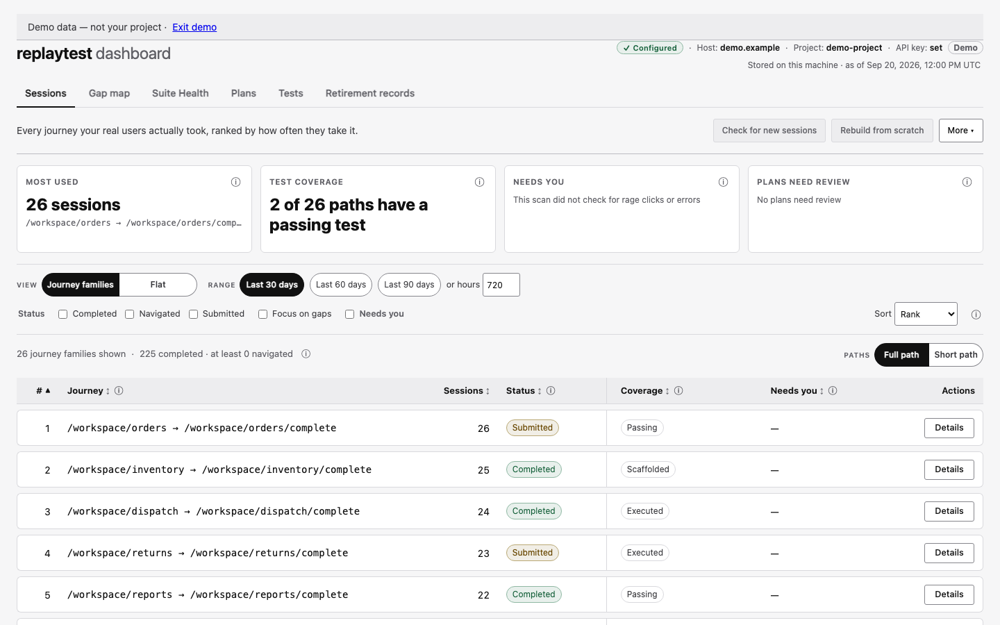
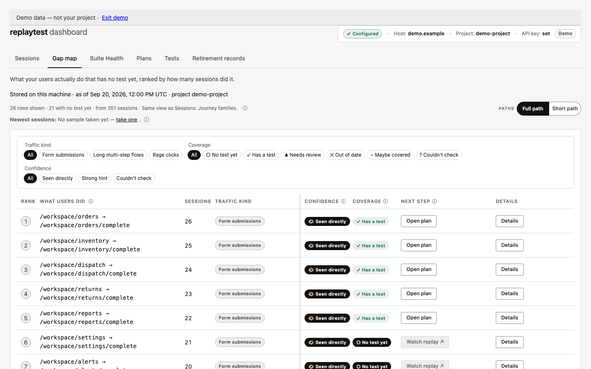
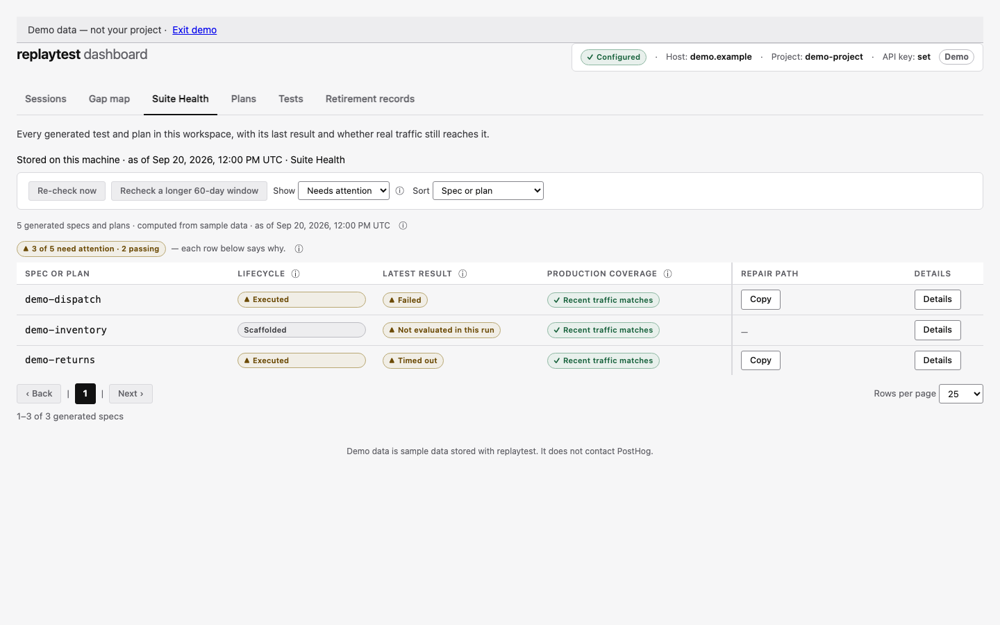
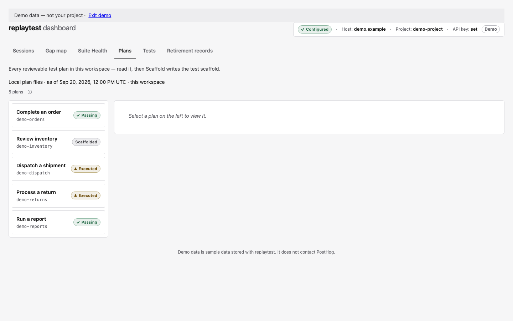
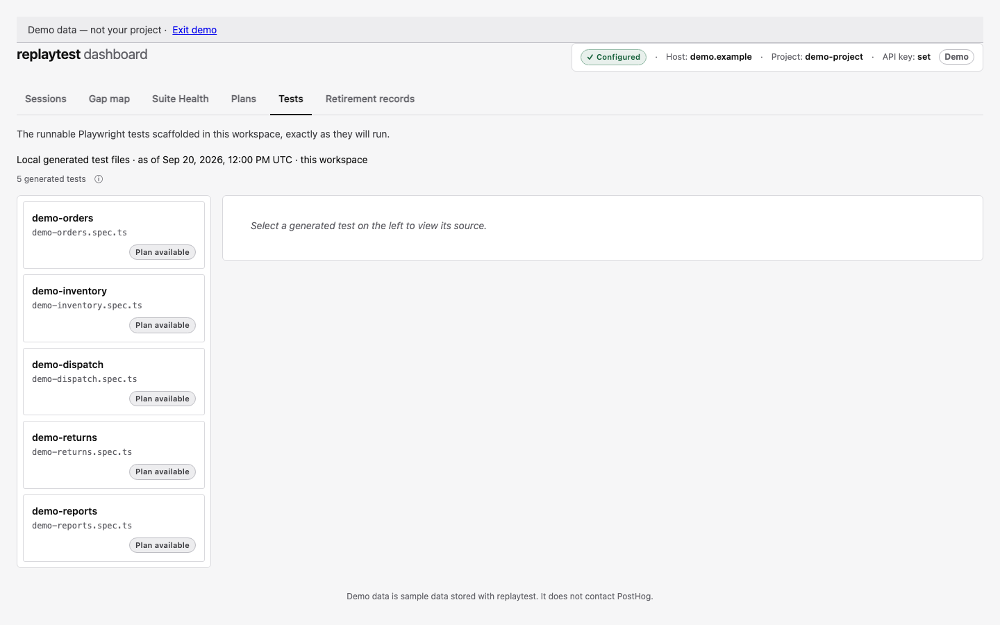

# Dashboard guide

`replaytest dashboard` starts a local browser page at `http://127.0.0.1:4319` (set `PORT` to use a different port). It shows the same data the commands read and write. Everything on it is also available as `--json` output or as a file on disk. The page only listens on `127.0.0.1`, so only your own machine can open it.

The dashboard page is drawn by your browser, so `curl /` returns an almost empty page. The same data is available as JSON under `/api/*` (for example `/api/plans`, `/api/sessions`, `/api/retired`), for scripts and AI coding agents.

This page goes through each tab in order. For each one it says what the tab is for and what its badges and ⓘ icons mean. It also says when the tab contacts PostHog and when it only reads data already on your machine.

## Demo dashboard

Open `/demo` to try a sample dashboard without connecting a project. It uses only made-up `demo.example` data. Actions that could write files or contact PostHog are turned off. Choose **Exit demo** to go back to your own dashboard, which the demo does not change. The demo only works when the dashboard is served at the root path.

---

## Conventions used on every tab

Two things repeat on every tab, so they are explained once here:

- **The ⓘ icon.** Every column header, and every unusual statement, has a small `ⓘ`. Hover over it, or move keyboard focus to it, to read a sentence with more detail. The label says something in plain words; the ⓘ says the same fact more exactly. It never adds a different fact. For the technical detail, look for the ⓘ before you look for documentation.
- **Where the data comes from.** The page footer says when the dashboard contacts PostHog: when you ask for new data, on its own to check that replays are still available, when an auto-check schedule you set runs, and when the stored data does not cover what you are viewing. Every view also says whether you are looking at a copy saved on your machine or at a fresh read. The dashboard never leaves you to guess how fresh the data is.

---

## Sessions

*Illustrative screenshot — the current UI may differ.*

**Purpose:** your starting point. It lists every journey your real users took (the pages one person went through in one visit), ranked by how often it happens. Your coding agent can pick a journey that matters, generate its plan, and turn real usage into a test.

**Summary cards:** four cards sit above the table. **Most used** names your most-taken journey. **Test coverage** says how many paths have a passing test. **Needs you** says whether any journey was flagged for a rage click or an error the recording caught, or that the scan did not check for them. **Plans need review** counts plans built under older journey-matching rules.

**Reading the row:** `Status` says what the *user* did (Completed / Navigated / Submitted / Abandoned). It does not say whether you have built anything for that journey. `Coverage` says how far you have got with an exact path: the stage its test has reached (Planned, Scaffolded, Executed or Passing). For a journey family it shows a count such as `N of M paths Passing`. `Needs you` shows `⚠ Needs a look` on a journey with a rage click or an error the recording caught, and `—` otherwise. The `Details` button opens a row's drawer to show the evidence behind that stage, the plan and test file paths, and when the test last ran. The drawer also shows any `≈ Suite` match, which is a best guess that one of your own hand-written tests already covers the journey.

**Views and filters:** `Journey families` puts the versions of one flow into a single ranked row, such as people who joined it at different pages or left at different steps (see [Concepts](./concepts.md#families)). `Flat` shows every exact recorded path on its own row. The toolbar holds the Range buttons (Last 30, 60 or 90 days, or a number of hours), the Status checkboxes (Completed, Navigated, Submitted), Focus on gaps, Needs you, and a Sort menu. The count line above the table shows figures such as `N completed · at least M navigated`. Those two figures count the two kinds of journey the tool can turn into a plan; every journey still appears in the table. The ⓘ next to the Status header explains, step by step, the evidence used to decide that a journey was completed.

Use Paths to switch between Full path and Short path. Full path is the default. Your choice is saved in this browser and shared by both the Sessions and Gap map tabs.

**App scope:** if your PostHog project records more than one app, you can show just one. In `.replaytest/config.json`, name each app and list its URL prefixes, for example `{"apps":{"shop":["https://shop.example"]},"app":"shop"}`. The dashboard then shows only sessions that visited a page under those prefixes. The ⓘ next to the stored-data line gives the details: the scope in use, how many sessions had no page addresses and so could not be matched to any app, and, when no scope is set and the traffic comes from more than one site, which sites those are. When other apps were left out, a notice says so and has a Copy button for the matching `replaytest sessions --app <name>` command. To change the scope, edit `.replaytest/config.json`. If the scope leaves nothing to show, the table area tells you the one thing to do next.

**Freshness controls — it reads saved data first:** opening the dashboard reads the last Sessions copy saved on this machine. It contacts PostHog on its own to check that replays are still available, and when the stored data does not cover what you are viewing. The data line shows when that copy was saved. **Check for new sessions** is the main button for fetching new data from PostHog. **Rebuild from scratch** sits next to it and asks you to confirm first. The Auto-check schedule is under **More**.

**Approximate data:** when you have a lot of sessions, the tab may use a quick summary scan instead of reading every session in detail (see [Concepts: exact vs. approximate scans](./concepts.md#exact-vs-approximate-scans--data-source-honesty)). The summary scan is faster, but its counts are close, not exact. When that happens, the count line says `≈ approximate — counts are close, not exact`. The ⓘ next to the data line shows how much of your history the scan covered.

---

## Gap map

*Illustrative screenshot — the current UI may differ.*

**Purpose:** it answers the opposite question from Sessions. Sessions asks "what do users do?"; the Gap map asks **"which of that has no test yet?"** Rows are ranked by how many sessions showed the same kind of traffic. Start at the top of "No test yet" and work down.

**Traffic kinds:** each row is one of the kinds of traffic described in [Concepts](./concepts.md#the-gap-map): form submissions, long multi-step flows, or rage clicks (many fast clicks in the same spot). The Traffic kind, Coverage and Confidence filters above the table narrow the rows to one kind, one coverage state or one confidence level.

**Confidence column:** every row says how sure the evidence is. `Seen directly` means exact evidence. `Strong hint` means the quick summary scan found a signal but could not tie it to this exact page. `Couldn't check` means this kind of scan cannot judge it at all. A `Couldn't check` row is never shown as if the answer were a plain "no".

**Coverage badges (color-coded, and always shown with words):** `No test yet` (dark — start here), `Has a test` (green), `Needs review` (yellow — a plan exists, but it was made under older journey-matching rules), `Out of date` (red — a newer plan has replaced this one), `Maybe covered` (gray — a best guess that one of your own hand-written tests covers it, not a guarantee), `Couldn't check` (gray — your existing tests could not be checked in this scan).

If a generated test file exists but cannot be read, the Gap map row shows `Couldn't check`, with a note that the test exists but could not be read. On the Sessions tab, the test badge still shows the test as present (`Tested ✓`), and a separate `ⓘ couldn't verify` disclosure says its coverage cannot be checked.

The `Next step` column gives you the next action for each row: Copy command (the exact command to run), Open plan, or Watch replay.

**Same view as Sessions:** the Gap map always uses the Journey families or Flat view that is selected on the Sessions tab, and the page says so. If you switch that setting on Sessions, the Gap map changes too. That way the two tabs always show the same rows and evidence.

**The spot-check panel:** above the traffic rows, a "Newest sessions" line says whether a spot-check sample has been taken. Its "See details" link (or "take one", when there is no sample yet) opens a separate "spot-check of your newest sessions" panel. The panel shows a small sample of your newest sessions. It reports things like screen sizes, whether logins were seen, and console errors. It is a quick look, not a claim about all your traffic, and the page says how the sample was taken.

- With no app scope set, it says how many sessions were asked for, how many came back, and the time window they cover.
- With an app scope set, it checks your newest project sessions one at a time. The limit is the smaller of 250 and the number of sessions returned. It keeps only those inside that scope and stops once it has enough, or when the time budget runs out. It says how many it checked, the most it would check, how many it kept, and the time window.

For older saved samples without a recorded limit, the panel leaves that limit out. The panel never fetches on its own; refreshing it is a CLI action that your coding agent runs on purpose.

---

## Suite Health

*Illustrative screenshot — the current UI may differ.*

**Purpose:** one place to decide which of your generated tests need attention. The line above the table says whether the list came from a saved result or was worked out again just now, and when. Each row has a drawer with the evidence behind it, and each piece of evidence has its own timestamp. A test file that exists but cannot be read still gets a row. It shows the reason and an unknown stage, and the dashboard does not call it missing or passing.

**Column-by-column:**
- **Spec or plan** — the short name (slug) of the plan and its test; the drawer has the full file path.
- **Lifecycle** — the stage the test has reached: `Planned`, `Scaffolded` (the test scaffold is written), `Executed` (it has been run) or `Passing`. If the stage is unknown, it says so rather than guessing.
- **Latest result** — `Passing`, `Failed`, `Timed out`, `Interrupted`, `Flaky` (it failed at least once, then passed on a retry), `Skipped`, `Not evaluated in this run`, `No generated spec`, or `Spec exists but could not be read`. This is a saved result from your last test run, not a new run.
- **Production coverage** — whether recent real traffic still matches this test: `Recent traffic matches`, `No recent matching traffic — review`, `Rechecking…`, or `Couldn't check`.
- **Repair path and Details** — the table has a Copy button where there is a command to run. The drawer has the full latest-result sentence, the diagnosis, what the coverage check was based on (its source, time window, matches and scan state), and the repair steps.

**Show and Sort:** the **Show** menu opens on `Needs attention` and also offers `Passing` and `All`. A passing result that is stale stays under Needs attention. A Flaky result also stays under Needs attention. **Sort** orders the rows by spec or plan, lifecycle, latest result or production coverage.

**Freshness controls:** the ⓘ next to the count line lists three times separately: when Suite Health was worked out, when `heal` was last run (the command that diagnoses every failure from one test run), and when your tests last really ran. It includes the raw UTC timestamps. **Re-check now** works everything out again. A longer-window recheck option looks further back in your traffic. If the saved result is older than your latest `heal` run, the tab says so, and it is not an all-clear.

---

## Plans

*Illustrative screenshot — the current UI may differ.*

**Purpose:** every test plan generated in this workspace, ready for your coding agent to review. A plan is the checkpoint between a recorded session and a runnable test.

**How to use it:** each plan in the list shows its title, its short name and a stage chip (`Planned`, `Scaffolded`, `Executed`, `Passing`, or `Couldn't check` when the stage is unknown). Pick a plan from the list on the left to read exactly what the test will do (**Steps**, each with the recommended way to find the element on the page) and what it will check (**Assertions**: the three kinds of check explained in [Concepts](./concepts.md#tier-1-assertions-and-the-honesty-boundary)). When a plan looks right, **Scaffold** writes the Playwright test scaffold from it. Your coding agent can read the same plans as JSON from `/api/plans`.

**Local-only:** plans are files under `.replaytest/plans/` in your workspace. Viewing and scaffolding them never contacts PostHog. This tab has no "check for new" button because there is nothing to check: a new plan appears here only after you run `replaytest plan`.

---

## Tests

*Illustrative screenshot — the current UI may differ.*

**Purpose:** the runnable Playwright test scaffolds `replaytest` has written from your plans. Your coding agent finishes them before you rely on them, for example by filling in hidden values and setting up login.

**How to use it:** pick a test on the left to read its code exactly as it will run. Tests are local files under `tests/generated/`, and viewing them never contacts PostHog. To create a new test, start from a plan on the Plans tab. To see how your existing tests are doing against real traffic, use Suite Health.

---

## Retirement records

**Purpose:** the retirement records saved in this workspace when someone retired a journey, that is, moved its local plan, test and related files aside. Each record shows what was moved, when that decision was recorded, and the evidence it was based on at the time. It is a history, not a live view of your application.

**How to use it:** each record card shows its archive ID, the record file, when it was retired, the evidence it was based on, and the files that were moved. An ⓘ explains any earlier records for the same journey. A folder that cannot be read, or that the tool does not recognise, still appears, with a plain-English explanation. A retirement that was interrupted shows as recovery-required, with the path to its journal (the log of the steps it took) and the command to resume it. If the journal itself cannot be read, it still appears so that your coding agent can inspect it.

**Empty or long lists:** an empty tab means this workspace has no stored retirement records. If the list reaches its limit, the dashboard says how many records or other rows were left out; inspect the local retirement folder for the rest. A damaged record is shown as unreadable, so it is never presented as a valid record.

**Local-only:** this tab only reads the retirement records on your machine. It does not contact PostHog, show the live state of your application, or prove that no replacement test exists.

---

## A note on these screenshots

The screenshots above come from the demo dashboard described near the top of this page, so they show only made-up sample data, and the demo banner and `Demo` badge appear in them. Controls the demo switches off, such as Watch replay and Re-check now, are drawn greyed out. The screenshots show each tab as it first appears: no row expanded, no plan or test selected, no individual session open. That is deliberate, for two reasons. It keeps the screenshots stable when your data changes, so they do not need constant retaking. It also avoids showing identifying details of any real session in the documentation. If you retake them, keep to the same rule: whole-tab views only.
